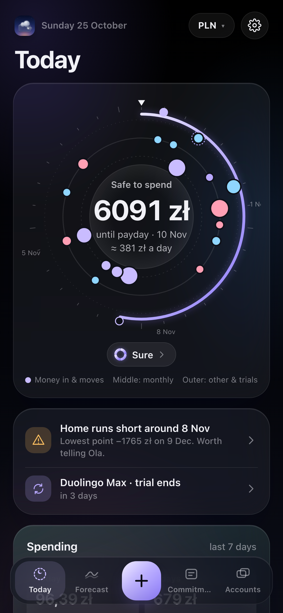
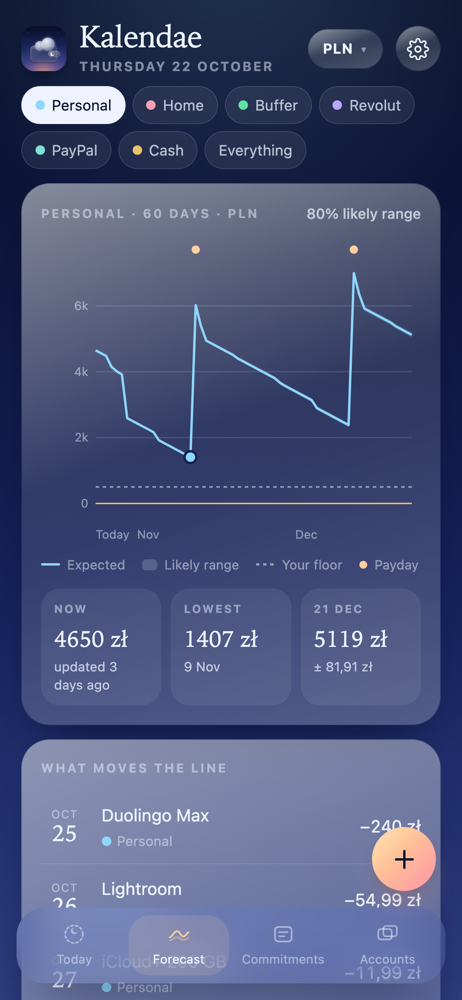
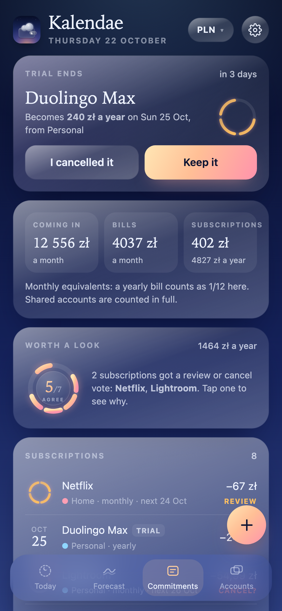
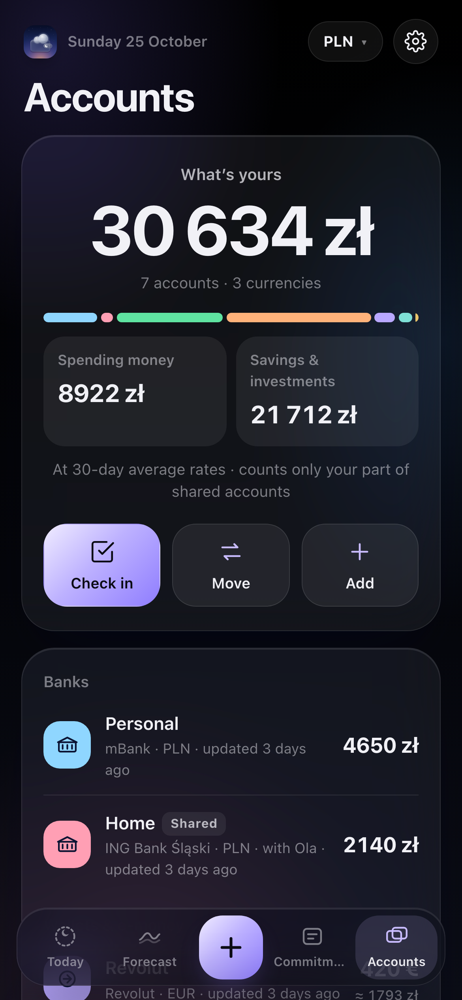

# Kalendae

**A forecast for your money: what's coming, and what's safe to spend until payday.**

No app store, no account, no bank login, no ads. Everything stays on your phone.

  
  
  
  

---

☕️ You can support me and Buy me a coffee ☕️

[https://buycoffee.to/szebastian](https://buycoffee.to/szebastian)

---

## What it does

- **Safe to spend until payday.** Takes your spending account, subtracts every bill, subscription and move dated before your next income and the cushion you choose to keep, and shows what's left, per day.
- **The month's orbit.** The next 30 days on three rings: money in and moves, monthly bills and subscriptions, and everything else including trials. Tap a dot to see what lands that day.
- **A 60-day forecast with a likely range.** Each account's balance day by day, with an 80% band that's wider when your everyday spending varies and narrower as you check in.
- **Every account, every currency.** Banks, savings, cards, PayPal, Revolut, Wise, Cash App, Venmo, BLIK, cash and about 400 banks and services worldwide, or any name you type. 33 currencies, converted at a 30-day average of the National Bank of Poland's rates.
- **Shared accounts.** A joint account or a pot you split 50/50 or by share. Only your part counts in what's yours.
- **Moves in any currency.** Count a move in the currency it really is, like USD stocks or EUR savings.
- **Subscriptions that earn their place.** Usage, price rises, cheaper plans and overlap vote keep, review or cancel, shown as a ring.
- **Trials.** Kalendae warns you 2 days before a trial turns paid, and on the day.
- **Weekly check-in.** Type today's balances (or count your cash note by note) and Kalendae works out what went on everyday things, then learns your real everyday spending.
- **Payday plan.** When income lands: what goes to bills, savings and everyday life, and what's free.
- **Notifications, not alarms.** One quiet notification a day around the time you choose, like Consensus Weather, even when the app is closed.
- **Three looks.** Night, Dawn and Paper.
- **17 languages.** English, Polski, Deutsch, Українська, Español, Français, Русский, 中文, 日本語, Português, Nederlands, Italiano, हिन्दी, العربية, Ελληνικά, Čeština and Svenska. Kalendae opens in your phone's language; change it in Settings. 16 more are coming in v1.1.

## Getting started

### Android app (recommended)

1. Open **[Releases](https://github.com/Szebastian31/kalendae/releases/latest)** on your phone and download **Kalendae_v….apk**.
1. Open the file. If Android asks, allow your browser to **install unknown apps**.
1. Open Kalendae and allow **notifications**, so Kalendae can tell you about renewals, bills and trial endings a few days ahead.

Updating: download the new APK and install it over the old one. Your data stays.

### iPhone or any browser

1. Open **[szebastian31.github.io/kalendae](https://szebastian31.github.io/kalendae/)**.
1. **iPhone (Safari):** tap **Share**, then **Add to Home Screen**. **Android (Chrome):** tap **⋮**, then **Install app**.

Notifications are only in the Android app.

### Just looking?

Settings → **Load sample data** fills Kalendae with a made-up month so you can see every screen. It replaces what's on the phone, so save a backup first if you've started.

## How accurate is it?

Kalendae is a forecast, not a bank statement. It only knows what you tell it: the balances you type and the dates you add. Everyday spending is an estimate until a few weekly check-ins have taught it your real pattern, and amounts in other currencies use a 30-day average rather than today's exact rate. "How sure is safe to spend?" on the Today screen shows how much of that is in place.

## Privacy

Everything stays on your phone. Your accounts, amounts and dates are saved on your device only and never uploaded. The only thing Kalendae downloads is the public exchange-rate table from the National Bank of Poland. Backups are files you save yourself, optionally locked with a password (AES-256).

---

_Kalendae is Latin for the first day of the Roman month, first set by the new moon, when debts fell due. The moneylender's ledger was a calendarium, which is where "calendar" comes from. It's a sibling to Consensus Weather, Fidelis, Vestis, Caelum, Hora and Augur._

For developers

The interface is plain HTML, CSS and JavaScript, hosted on GitHub Pages. The Android app (`app/`) bundles those same files into a native WebView shell that adds a daily notification about what's coming up, sent even when the app is closed (an inexact daily check, like Consensus Weather, re-planned after a restart), saving and opening backup files, the share sheet and vibration. GitHub Actions builds the APK on every push and publishes it as a release.

| File | What it does |
| --- | --- |
| `index.html` | Layout and styles |
| `i18n.js`, `i18n/` | Languages: `t('English text')` in the code, one file per language mapping each text to its translation |
| `store.js`, `money.js` | Saving on the phone, backups, currencies and NBP exchange rates |
| `items.js`, `subs.js` | Income, bills, subscriptions, moves, the forecast maths, and the keep / review / cancel vote |
| `checkin.js`, `notify.js` | Weekly check-ins and cash count, and the notifications handed to Android |
| `today.js`, `forecast.js`, `commit.js`, `accounts.js`, `settings.js` | The screens |
| `banks.js`, `ui.js`, `app.js` | Banks around the world, shared helpers, the app shell |
| `icons/icon.js` | The icon drawing, used by the app and `icons.html` |
| `icons/icon.svg`, `icons.html` | The icon, and a page that exports the PNG icons |
| `manifest.webmanifest`, `sw.js` | Home-screen install and offline cache |
| `app/` | Android app: WebView shell, daily notifications, backup files, launcher icon, translated notification channel names |
| `.github/workflows/build.yml` | Builds the APK and publishes it as a release |

After changing any file, bump `VERSION` in `sw.js` so installed web copies update, and `versionName` + `versionCode` in `app/build.gradle` for a new APK release. A `.js` file at the repo root or in `i18n/` is bundled into the APK automatically; add it to `index.html` (root files) and `sw.js` too.

**Adding a language:** copy `i18n/pl.js` to `i18n/xx.js`, change `I18N.pl` to `I18N.xx` and translate the right-hand side of each line. Plurals are objects with the forms `Intl.PluralRules` uses for that language (`one`, `few`, `many`, `other`…). Then add the code to `LANGS` in `i18n.js`, the file to `sw.js`, and optionally `app/src/main/res/values-xx/strings.xml` for the notification channel names. A line that's missing simply shows in English.

